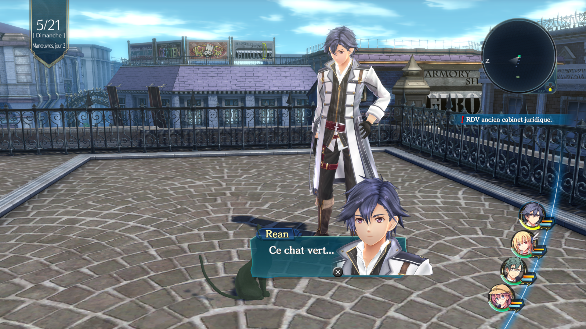

# Koppe Vert CS3
Alors vous avez déjà fait Koppe vert dans CS2 mais vous voulez toujours obtenir le même façon dans CS3? Pas de problème ! Ce mod devrait transformer notre chat favori au vert comme avant ! Maintenant, avec le dialogue modifié où les personnages font référence à Koppe comme un chat vert !

## Instructions d'installation
- SenPatcher: Vous pouvez just simply copier les fichiers p3a, et collez-le au dossier mod vers votre répertoire Trails of Cold Steel III (usually in C:\Fichiers de programme (x86)\Steam\steamapps\common\The Legend of Heroes Trails of Cold Steel III\mods).
  - Il est possible d’installer l’un ou l’autre des fichiers p3a, ou bien les deux simultanément. Consultez la rubrique « Remarques » pour plus d’informations.
- Non-SenPatcher: Copier le fichier C_CHR958_C08.pkg et le dossier "fr" du dossier modifié, et collez-le dans C:\Fichiers de programme (x86)\Steam\steamapps\common\The Legend of Heroes Trails of Cold Steel III\data\asset\D3D11_us.
  - (OPTIONNEL) Si vous voulez le texte mise à jour, de plus copier c0200.dat du dossier modifié, et collez-le dans C:\Fichiers de programme (x86)\Steam\steamapps\common\The Legend of Heroes Trails of Cold Steel III\data\scripts\scena\dat_en (anglais) ou dat_fr (français), et écraser le fichier.

## Instructions de désinstallation
- SenPatcher: Vous pouvez tout simplement supprimer deux fichiers p3a dans le dossier mods.
- Non-SenPatcher: Supprimer le fichier C_CHR958_C08.pkg dans C:\PFichiers de programme (x86)\Steam\steamapps\common\The Legend of Heroes Trails of Cold Steel III\data\asset\D3D11_us.
  - Si vous avez installé le mod avec le texte, copier c0200.dat du dossier d'origine, et collez-le dans C:\Fichiers de programme (x86)\Steam\steamapps\common\The Legend of Heroes Trails of Cold Steel III\data\scripts\scena\dat_en (anglais) ou dat_fr (français), et écraser le fichier.

## Remarques
- shinyCoppe.p3a ne change que Koppe à vert, mais le dialogue est le même.
- shinyCoppeDialogue.p3a ne change que les dialogues pour faire référence à Koppe comme un chat vert, mais Koppe lui-même est le même.

## Crédits
Ce mod ne serait pas possible sans :
- [SenPatcher](https://github.com/AdmiralCurtiss/SenPatcher) par AdmiralCurtiss
- [ED8 Model Toolset](https://github.com/eArmada8/ed8pkg2gltf) par eArmada8
- [Kiseki Modding Server](https://discord.gg/wYkWS33NQt) pour m'aider quand j'étais coincé.

For English, see [README.md](README.md)  

Amusez-vous !
