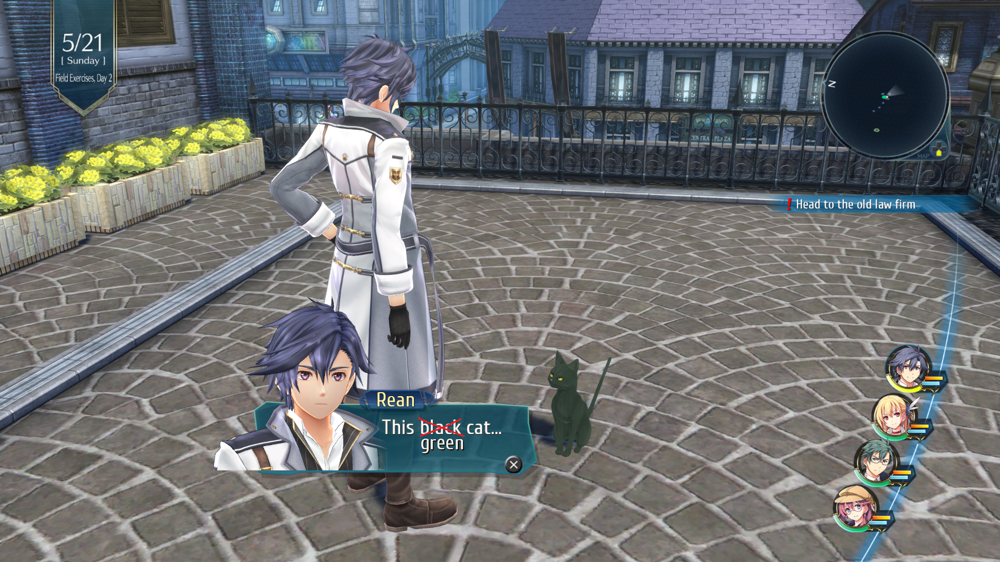

# Green Coppe CS3
So you already got Coppe green in CS2 but still want it the same way in CS3? Not a problem! This mod should turn our favorite pussycat green like before!

## Installation Instructions
- SenPatcher: You can just simply copy the p3a file, and paste it to the mod folder in your Trails of Cold Steel III directory (usually in C:\Program Files (x86)\Steam\steamapps\common\The Legend of Heroes Trails of Cold Steel III\mods).
- Non-SenPatcher: Copy the C_CHR958_C08.pkg file in the edited folder, and paste it in C:\Program Files (x86)\Steam\steamapps\common\The Legend of Heroes Trails of Cold Steel III\data\asset\D3D11_us, and overwrite the file.

## Uninstallation Instructions
- SenPatcher: You can just simply delete the p3a file in the mods folder.
- Non-SenPatcher: Delete the the C_CHR958_C08.pkg file in C:\Program Files (x86)\Steam\steamapps\common\The Legend of Heroes Trails of Cold Steel III\data\asset\D3D11_us

## Credits
This mod would not be possible without:
- [SenPatcher](https://github.com/AdmiralCurtiss/SenPatcher) by AdmiralCurtiss
- [ED8 Model Toolset](https://github.com/eArmada8/ed8pkg2gltf) by eArmada8
- [Kiseki Modding Server](https://discord.gg/wYkWS33NQt) for helping me when I got stuck.

Have fun!
